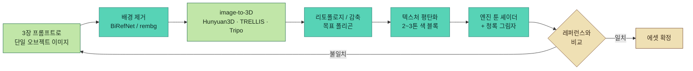

# 아트 스타일 프롬프트 가이드 — "바람의 섬" 룩

`wind.mp4`(1080×1920, 62초, 세로 쇼츠 안에 게임 화면 1080×1080 영역)를 프레임 단위로 분석해 정리한 스타일 바이블과, 이미지 생성 / 3D 모델 생성용 프롬프트 모음입니다.

- 참조 프레임: `docs/style-reference/frame_*.jpg` (자막 영역을 잘라낸 크롭)
- 프롬프트 본문은 **영어**로 작성했습니다. fal(FLUX, Recraft, Ideogram 등)·Midjourney·SDXL 계열 모두 영어 프롬프트에서 스타일 고정력이 가장 높습니다. [중간]
- 원본 게임의 캐릭터·UI를 그대로 복제하는 용도가 아니라, **렌더링 스타일과 색 언어**를 재현하는 용도입니다. 고유 캐릭터는 아래 템플릿에 자기 디자인을 넣어 쓰세요.

---

## 1. 스타일 분석 (영상에서 관찰한 사실)

### 1.1 전체 인상
밝은 한낮의 섬, 채도 높은 초록 초원과 청록 바다가 화면의 80% 이상을 차지합니다. 렌더링은 **애니메 셀 셰이딩 + 페인터리 텍스처**의 혼합으로, 영상 내레이션도 "렌더링은 원신 느낌"이라고 명시합니다. 다만 실제 화면은 원신보다 **더 단순한 로우폴리 실루엣**과 **더 두꺼운 잔디 레이어**가 특징이라, 원신 + 스튜디오 지브리 배경화 + 로우폴리 인디 게임의 중간쯤입니다. [높음]

### 1.2 관찰된 요소 목록

| 요소 | 관찰 내용 | 근거 프레임 |
|---|---|---|
| 카메라 | 높은 탑다운 3/4 뷰(약 50~65° 내려다봄), 활공 시 더 높아짐. 수중은 3인칭 뒤쪽 | 01s, 07s, 24s |
| 잔디 | 개별 블레이드가 보이는 촘촘한 GPU 잔디, 바람에 한 방향으로 쏠림, 흰·노랑·분홍 작은 꽃이 점처럼 산포 | 07s, 50s |
| 나무 | 둥근 덩어리(클럼프) 형태의 캐노피, 셀 셰이딩 2~3단 명암, 어두운 갈색 가는 줄기 | 01s |
| 덤불 | 구형 덤불, 아래쪽에 짙은 초록 AO 그림자 | 50s |
| 흙길 | 크림/베이지(#e8d3a0 근처) 평면 색, 가장자리가 잔디로 불규칙하게 먹힘 | 50s |
| 물 | 얕은 곳 민트-청록 → 깊은 곳 코발트 블루 그라데이션, 흰 원형 물결 링, 수련잎, 부들(cattail) | 01s, 31s |
| 해변 | 크림색 모래 띠가 물과 잔디 사이를 부드럽게 구분 | 01s, 07s |
| 수중 | 연한 청록 안개, 굵은 갓레이(god ray), 모래 바닥, 둥근 조약돌, 해초, 로우폴리 바위 | 24s |
| 캐릭터 | 2~3등신 치비 비율, 둥글고 통통한 몸, 갈색 계열, 배낭/모자 같은 큰 소품, 윤곽선 없음 | 07s, 24s |
| 탈것/장비 | 흰-분홍 깃털 날개(활공), 청록·크림 줄무늬 낙하산 | 01s, 07s |
| 이펙트 | 반투명 민트-흰색 바람 소용돌이 링, 흩날리는 흰 깃털/꽃잎 | 46s 부근 |
| 바위 | 각진 로우폴리 회색-청회색 바위, 평면 셰이딩 | 24s |
| 건물 | 원경에 빨간 지붕 + 흰 벽의 아담한 마을 집 | 46s 부근 |
| UI | 반투명 짙은 남색 알약형 패널 + 흰 텍스트, 작은 원형 아이콘 | 07s |
| 지도 | 손그림 느낌 일러스트 맵: 연두 평원, 갈색 절벽, 청록 바다, 붉은 해안 절벽 | 52s 부근 |

### 1.3 측정 팔레트
3개 대표 프레임(초원·수중·흙길)에서 `ffmpeg palettegen`으로 추출한 16색입니다. [높음 — 실제 픽셀 기반]

| 역할 | HEX |
|---|---|
| 잔디 하이라이트 | `#c1e6a8`, `#81d465` |
| 잔디 미드톤 | `#5bb94f`, `#3aa13b`, `#348832` |
| 잔디/숲 그림자 | `#256d4b`, `#254633` |
| 청록 (얕은 물·수중 안개) | `#57d3b6`, `#4eb790`, `#2b8277` |
| 물 (중간~깊은) | `#13b4c3`, `#2597b1` |
| 밝은 하늘/빛 | `#ddf8d1`, `#afcba0` |
| 모래/흙길 (육안 보정) | `#efe0b4`, `#e2c98f` |
| 캐릭터 갈색 (육안 보정) | `#b9804f`, `#7a4f30` |

**핵심 규칙:** 그림자는 검정·회색이 아니라 **청록-짙은 초록**으로 떨어집니다. 이게 이 룩의 가장 큰 식별자입니다. [높음]

### 1.4 스타일 키워드 요약
`stylized anime cel-shading` · `painterly textures` · `lush dense grass` · `high-saturation greens & turquoise` · `teal-tinted shadows` · `chibi chunky characters` · `low-poly rocks` · `soft bloom` · `bright midday sun` · `no outlines`

---

## 2. 공통 스타일 블록

모든 프롬프트 앞(또는 뒤)에 붙이는 고정 문구입니다. 이 블록을 바꾸지 않는 것이 에셋 간 일관성의 핵심입니다.

### 2.1 STYLE_CORE (이미지용)
```
stylized 3D game art, anime cel-shaded rendering with soft painterly textures,
lush vibrant meadow greens and clear turquoise water, bright midday sunlight,
shadows tinted teal and deep green (never gray or black), soft bloom,
gentle ambient occlusion, clean readable shapes, no outlines,
cozy open-world adventure game aesthetic, high saturation but harmonious palette
(#81d465, #3aa13b, #256d4b, #57d3b6, #13b4c3, #efe0b4)
```

### 2.2 NEGATIVE (네거티브 프롬프트 지원 모델용)
```
photorealistic, realistic skin, gritty, dark, desaturated, muted colors,
gray shadows, black outlines, heavy linework, harsh specular, metallic PBR look,
horror, noise, film grain, blurry, lowres, jpeg artifacts, text, watermark, logo,
extra limbs, deformed hands
```
> FLUX 계열은 네거티브 프롬프트를 지원하지 않습니다. 그 경우 "Avoid: ..." 문장을 본문 끝에 붙이는 방식은 효과가 약하므로[중간], 대신 STYLE_CORE의 긍정 표현("shadows tinted teal", "no outlines")으로 제어하세요.

### 2.3 스타일 고정 팁
1. **참조 이미지 사용**: fal의 FLUX Redux / FLUX Kontext / IP-Adapter 계열에 `docs/style-reference/frame_07s.jpg`(초원), `frame_24s.jpg`(수중)를 스타일 레퍼런스로 넣으면 텍스트만 쓸 때보다 일관성이 확실히 올라갑니다. [중간]
2. **시드 고정**: 같은 카테고리 에셋은 같은 seed로 시작해 변주합니다.
3. **첫 결과를 앵커로**: 마음에 드는 키아트 1장이 나오면, 이후 모든 생성의 스타일 레퍼런스로 그 이미지를 씁니다(영상 원본보다 저작권상 안전).

---

## 3. 이미지 프롬프트 (2D)

생성 흐름은 키아트로 룩을 확정한 뒤, 그 키아트를 레퍼런스로 하위 에셋을 뽑는 순서입니다.

```
키아트(룩 확정) → 환경 컨셉 → 캐릭터 시트 → 소품/크리처 → UI·지도
       ↑ 스타일 레퍼런스로 계속 재사용 ──────────────┘
```

### 3.1 키아트 / 무드 샷
```
[STYLE_CORE]
high-angle three-quarter top-down view of a small grassy island coast,
a crescent beach of cream sand curving around a clear turquoise lagoon
that deepens to cobalt blue, white ripple rings on the water, lily pads and cattails,
dense windswept grass with tiny white, yellow and pink wildflowers,
round clumpy cel-shaded trees, a tiny chibi adventurer gliding with feathered wings,
white seabirds flying over the water, aspect ratio 1:1
```

### 3.2 환경 컨셉

**초원 + 흙길**
```
[STYLE_CORE]
top-down 60-degree game camera view of a rolling meadow,
a winding cream-beige dirt path with soft irregular grass edges,
thick individual grass blades all leaning in one wind direction,
scattered daisies and yellow buttercups, round bushes with dark teal-green contact shadows,
small angular low-poly gray rocks, sunny, peaceful
```

**호숫가 / 선착장**
```
[STYLE_CORE]
top-down view of a lakeshore, small weathered wooden pier stretching into turquoise water,
sandy shoreline band, cattails and reeds at the edge, lily pads with pink blossoms,
round pebbles visible through clear shallow water, soft caustic light patterns
```

**수중**
```
[STYLE_CORE]
underwater third-person view, pale turquoise haze, strong soft god rays from the surface,
sandy seabed with round blue-teal pebbles, tall swaying seagrass,
faceted low-poly mossy boulders, small coral sprigs, floating bubbles,
dreamy and bright, not dark
```

**마을 (원경)**
```
[STYLE_CORE]
small cozy seaside village on a grassy hill, cottages with red tiled roofs and white plaster walls,
wooden fences, dirt paths, round trees, seen from a high three-quarter game camera, sunny
```

**절벽 / 고지대**
```
[STYLE_CORE]
grassy plateau edge dropping into layered brown rock cliffs, stylized painterly rock strata,
trees on top of the cliff, turquoise sea below, high-angle view
```

### 3.3 캐릭터

**캐릭터 턴어라운드 시트 (템플릿)**
```
[STYLE_CORE]
character turnaround sheet, front, side, back and three-quarter views,
chibi proportions about 2.5 heads tall, round chunky body, short stubby limbs,
[캐릭터 설명: 예) a small bear-like explorer with warm brown fur,
oversized canvas backpack, teal scarf, little brown cap],
simple flat color blocks with 2-tone cel shading, soft teal shadows,
plain light background, consistent design across views, T-pose-friendly silhouette
```
- 3D 변환까지 갈 캐릭터는 **정면 A-pose / T-pose, 단색 배경, 소품이 몸에서 분리**되게 그리는 게 image-to-3D 품질을 크게 좌우합니다. [높음]

**표정·포즈 시트**
```
[STYLE_CORE]
expression and pose sheet of the same chibi character: idle, running, gliding with
white-and-pink feathered wings, parachuting, swimming, picking flowers, happy, surprised,
consistent proportions, light background
```

### 3.4 크리처 / NPC
```
[STYLE_CORE]
cute stylized [동물: 예) round puffy seabird / chubby lake fish / small fox],
simple rounded shapes, 2-tone cel shading, big readable silhouette,
game creature concept, three views, light background
```

### 3.5 소품 / 장비 (아이템 시트)
```
[STYLE_CORE]
game prop sheet on a light background, isolated objects, evenly spaced:
striped teal-and-cream parachute, white feathered glider wings with pink tips,
wooden fishing rod, small woven basket of wildflowers, wooden signpost,
weathered wooden pier segment, low-poly mossy boulder, round clumpy tree,
consistent lighting from top-left
```

### 3.6 이펙트 컨셉
```
[STYLE_CORE]
VFX concept sheet: translucent mint-white spiral wind vortex rings,
streaking wind trails, drifting white feathers and flower petals,
water splash with white ripple rings, soft additive glow, dark-free palette
```

### 3.7 아이콘
```
[STYLE_CORE]
game inventory icon of [아이템], centered, simple chunky shape,
cel-shaded with soft highlight, subtle teal rim shadow, transparent background,
512x512, readable at small size
```

### 3.8 UI / HUD
```
flat game HUD elements, semi-transparent dark navy rounded pill panels (#1c2638 at 75% opacity)
with white clean sans-serif text, small round icon badges, thin soft borders,
minimal and readable over bright green scenery, isolated on transparent background
```
> 텍스트(특히 한글)는 이미지 모델이 거의 망가뜨립니다. UI는 **패널·프레임만 생성**하고 글자는 엔진에서 렌더링하세요. [높음]

### 3.9 월드맵
```
hand-painted illustrated fantasy island map, top-down, soft watercolor and gouache texture,
light green meadows, brown layered cliffs on the east, red-brown coastal cliffs on the west,
turquoise sea with subtle white wave lines, winding cream dirt paths, small icons for
village, lake, ruins and forest, no text labels, parchment-free clean edges
```

---

## 4. 3D 모델링 프롬프트

### 4.1 권장 파이프라인
텍스트 → 3D 직행보다 **이미지 → 3D**가 스타일 일치도가 높습니다. [중간 — 2025~2026 기준 Hunyuan3D, TRELLIS, Tripo, Meshy, Rodin 모두 이미지 입력 품질이 텍스트 입력보다 안정적]

절차는 다음과 같습니다. 3장의 프롬프트로 단일 오브젝트 정면 이미지를 만들고, 배경을 제거한 뒤, image-to-3D로 메시를 얻고, 리토폴로지·텍스처 단순화를 거쳐 엔진에서 툰 셰이더를 입힙니다. 결과가 스타일에서 벗어나면 이미지 단계로 되돌아갑니다.



### 4.2 image-to-3D용 입력 이미지 프롬프트 (공통 접미사)
3D 변환 입력 이미지는 아래 접미사를 반드시 붙입니다.
```
single isolated object, centered, full body in frame, front three-quarter view,
neutral even lighting, no cast shadow on ground, plain white background,
simple solid color regions, clean silhouette, no motion blur, no text
```

### 4.3 텍스트 → 3D 프롬프트 (Meshy / Tripo / Rodin 텍스트 모드)

**공통 3D 스타일 블록 (STYLE_3D)**
```
stylized low-poly game asset, cel-shaded anime style, smooth rounded forms,
flat hand-painted colors with 2-3 tone shading, no realistic PBR, no fine noise detail,
vibrant greens and turquoise accents, game-ready, clean topology
```

| 에셋 | 프롬프트 (STYLE_3D 뒤에 붙임) | 목표 폴리곤 [중간] |
|---|---|---|
| 플레이어 캐릭터 | `chibi explorer character, 2.5 heads tall, round chunky body, warm brown fur, oversized canvas backpack, teal scarf, A-pose` | 5k–12k tris |
| 활공 날개 | `pair of white feathered glider wings with pink tips, layered chunky feathers, attachable to back` | 1k–2k |
| 낙하산 | `round canopy parachute with alternating teal and cream stripes, coral center ring, four ropes` | 1k–2k |
| 둥근 나무 | `stylized tree with clumpy round canopy made of 4-6 blobs, thin dark brown trunk` | 1k–3k |
| 덤불 | `round puffy bush made of overlapping spheres` | 300–800 |
| 바위 | `faceted angular low-poly boulder, blue-gray with mossy green top` | 100–400 |
| 조약돌 세트 | `set of 6 smooth rounded flat pebbles, teal-blue and gray` | 50–150 each |
| 선착장 | `small weathered wooden pier with planks and posts, slightly uneven boards` | 1k–2k |
| 마을 집 | `cozy cottage, white plaster walls, red tiled roof, wooden door, chimney, chunky proportions` | 2k–5k |
| 부들/갈대 | `cluster of cattails and reeds, brown seed heads, thin green stalks` | 200–600 |
| 수련 | `lily pad with small pink lotus flower` | 100–300 |
| 물고기 | `chubby cute lake fish, rounded body, big fins, teal and cream colors` | 500–1.5k |
| 새 | `round puffy white seabird, simple wings, tiny beak` | 500–1.5k |
| 해초 | `tall wavy seagrass blades cluster, alpha-card friendly` | 200–500 |

### 4.4 엔진 렌더링 사양 (모델만으로는 룩이 안 나옵니다)
모델링보다 **셰이딩·잔디·포스트 프로세싱**이 이 룩의 60% 이상을 결정합니다. [중간] 엔진(Three.js / Unity URP / Godot)에서 맞출 값:

| 항목 | 설정 |
|---|---|
| 라이팅 모델 | 램버트 기반 2~3단 스텝(ramp texture), 경계는 약간 부드럽게(smoothstep 폭 0.05~0.1) |
| 그림자 색 | 곱하기 회색 대신 `#256d4b`~`#2b8277` 방향으로 색 보정 |
| 림 라이트 | 약한 흰-민트 림(강도 0.2~0.3), 캐릭터에만 |
| 아웃라인 | 사용 안 함 |
| 잔디 | GPU 인스턴싱 블레이드, 뿌리 `#256d4b` → 끝 `#c1e6a8` 그라데이션, 버텍스 바람 흔들림 + 노이즈 기반 바람 패턴, 꽃은 별도 인스턴스로 흰/노랑/분홍 점 |
| 물 | 깊이 기반 색 혼합(`#57d3b6` → `#13b4c3` → `#2597b1`), 해안선 폼 띠, 상호작용 링 데칼 |
| 수중 | 거리 안개 `#57d3b6`, 스크린 갓레이, 화면 색수차 없음 |
| 포스트 | 블룸(임계값 높게, 강도 약하게), 채도 +10~15%, 약한 비네트 |
| 하늘/환경광 | 밝은 민트-하늘색 앰비언트, 그림자가 탁해지지 않게 앰비언트 강도 높게 |

---

## 5. 생성 체크리스트

각 에셋을 확정하기 전 아래를 확인합니다.

```
생성 → 그림자 색 확인 → 실루엣 확인 → 팔레트 대조 → 레퍼런스 나란히 비교 → 확정
           ↓ 회색/검정                ↓ 범위 밖 색
         재생성                     재생성
```

- [ ] 그림자가 회색·검정이 아니라 청록/짙은 초록인가
- [ ] 윤곽선이 없는가
- [ ] 50% 축소해도 실루엣이 읽히는가 (탑다운 카메라 기준)
- [ ] 1.3 팔레트에서 크게 벗어난 색이 없는가
- [ ] `docs/style-reference/` 프레임과 나란히 놓았을 때 같은 게임처럼 보이는가
- [ ] (3D) 텍스처에 사실적 노이즈·PBR 금속감이 남아 있지 않은가

---

## 6. codex(gpt-image-2)로 생성하기

이 프로젝트의 2D 에셋(키아트, 텍스처, 아이콘, 월드맵, image-to-3D 입력 이미지)은 **codex CLI의 내장 `image_gen` 도구(gpt-image-2)** 로 생성합니다. ChatGPT OAuth로 로그인된 codex를 쓰므로 API 키가 필요 없습니다. 다만 OAuth 토큰으로 OpenAI REST API를 직접 호출하면 401이 나므로, 반드시 `codex exec`를 거쳐야 합니다. [높음]

### 6.1 호출 방법
`codex exec`에 생성 지시를 자연어로 주고, 결과 PNG를 프로젝트 경로로 복사하게 합니다. `-i`로 붙인 참조 이미지는 codex가 보고 프롬프트에 반영합니다.

```bash
codex exec "Perform the following tasks:
1. Look at the attached reference image ONLY for rendering style and color palette
   (do not copy its characters, UI, or layout).
2. Use the built-in image_gen tool to generate ONE image. Prompt: '<STYLE_CORE> <장면/에셋 설명>'
3. Size: 1024x1024. Quality: medium.
4. Copy the generated image to '<프로젝트 절대경로>/assets/textures/<이름>.png'. Print the saved path and size." \
  -i docs/style-reference/frame_50s.jpg \
  -C "$(pwd)" -s workspace-write -c 'model_reasoning_effort="low"' --skip-git-repo-check
```

| 항목 | 값 |
|---|---|
| 크기 | `1024x1024`, `1024x1536`, `1536x1024`, `auto` |
| 품질 | `low`(초안, 약 1분) · `medium`(기본) · `high`(최종 키아트) |
| 소요 시간 | 1장 약 1~2분, 타임아웃은 3분 이상으로 [중간 — 1회 실측] |
| 프롬프트 안 따옴표 | `"`는 `'`로 바꿔야 `codex exec "..."` 인자가 깨지지 않음 |
| 파일명 | 덮어쓰지 않도록 이름에 번호/타임스탬프 |

### 6.2 실측으로 확인한 gpt-image-2의 경향
`frame_50s.jpg`를 참조로 붙이고 3.2 "초원 + 흙길" 프롬프트로 1장 생성해 레퍼런스와 나란히 비교했습니다. [높음 — 1회 실측, 표본 1장]

| 항목 | 결과 | 대응 |
|---|---|---|
| 팔레트·청록 그림자 | 잘 맞음 | STYLE_CORE 그대로 사용 |
| 카메라 각도 | **"top-down 60°"를 무시하고 지평선·하늘이 보이는 일러스트 구도로 바뀜** | 아래 6.3 접미사로 강하게 고정 |
| 렌더링 | 게임 화면보다 디테일이 많은 애니 배경화 쪽으로 감 | "in-game screenshot", "simple stylized shapes" 명시 |
| 잔디 밀도 | 레퍼런스보다 성기고 사실적 | "thick carpet of stylized grass blades" 명시 |

### 6.3 용도별 접미사
STYLE_CORE 뒤에 용도에 맞는 접미사 하나를 붙입니다.

**게임 화면 구도 (키아트·환경 컨셉)**
```
in-game screenshot of a stylized 3D game, camera looking steeply down at the ground
from high above at about 60 degrees, NO horizon, NO sky visible, the ground fills the whole frame,
simple stylized shapes, thick carpet of stylized grass blades, no text, no UI
```

**타일 텍스처 (`assets/textures/terrain/`)**
```
seamless tileable texture, orthographic view straight down, flat even lighting, no perspective,
no shadows from outside objects, edges wrap perfectly, painterly cel-shaded game texture
```
> gpt-image-2가 진짜 이음매 없는 타일을 보장하지는 않습니다. [중간] 생성 후 Godot에서 2×2로 깔아 보고, 이음매가 보이면 오프셋 블렌딩으로 후처리합니다.

**아이콘·소품 (투명 배경)**
```
single isolated object, centered, transparent background with real alpha channel,
no backdrop, no checkerboard, no drop shadow, no border
```
> image_gen에는 `background: transparent` 파라미터를 넘길 수 없어 프롬프트로만 요청합니다. 저장 후 Pillow로 RGBA인지, 네 모서리 알파가 0인지 확인하고, 실패하면 1회만 재생성한 뒤 그래도 실패하면 `rembg`로 배경을 제거합니다. [중간]

**image-to-3D 입력 / 모델링 참고 시트**
4.2의 공통 접미사를 그대로 씁니다(흰 단색 배경, 정면 3/4, 그림자 없음).

### 6.4 참조 이미지 사용 원칙
1. 첫 1~2장만 `docs/style-reference/` 프레임을 참조로 붙입니다. 프롬프트에 **"style and palette only, do not copy characters, UI, or layout"** 을 반드시 넣습니다.
2. 마음에 드는 자체 키아트가 나오면 `docs/style-reference/keyart_*.png`로 저장하고, 이후에는 **원본 영상 프레임 대신 자체 키아트를 참조로** 씁니다. 원본 게임 화면에 계속 기대지 않아야 결과물이 오리지널로 남습니다.
3. 같은 카테고리(예: 아이콘 전체)는 같은 참조 이미지 + 같은 접미사로 한 번에 뽑아 톤을 맞춥니다.

생성 흐름은 다음과 같습니다.

```
프레임 참조로 키아트 생성 → 자체 키아트 확정(keyart_*.png) → 키아트 참조로 텍스처·아이콘·맵 생성 → 5장 체크리스트
                                                                    ↓ 불합격
                                                                  재생성
```

### 6.5 3D와 오디오는 codex 범위 밖
gpt-image-2는 2D 이미지만 만듭니다. 이 프로젝트에서 3D 모델은 Blender 헤드리스 스크립트(`blender -b -P`)로 절차적 로우폴리 메시를 만들어 `.glb`로 내보냅니다. 색은 버텍스 컬러로 넣고, 룩은 `shaders/toon.gdshader`가 결정합니다. 이때 codex 이미지는 **모델링 참고 시트**(4.3 표의 프롬프트 + 4.2 접미사)로만 씁니다. 오디오는 사양 문서와 합성 플레이스홀더로 대체합니다(`docs/team-contract.md` 1장).
